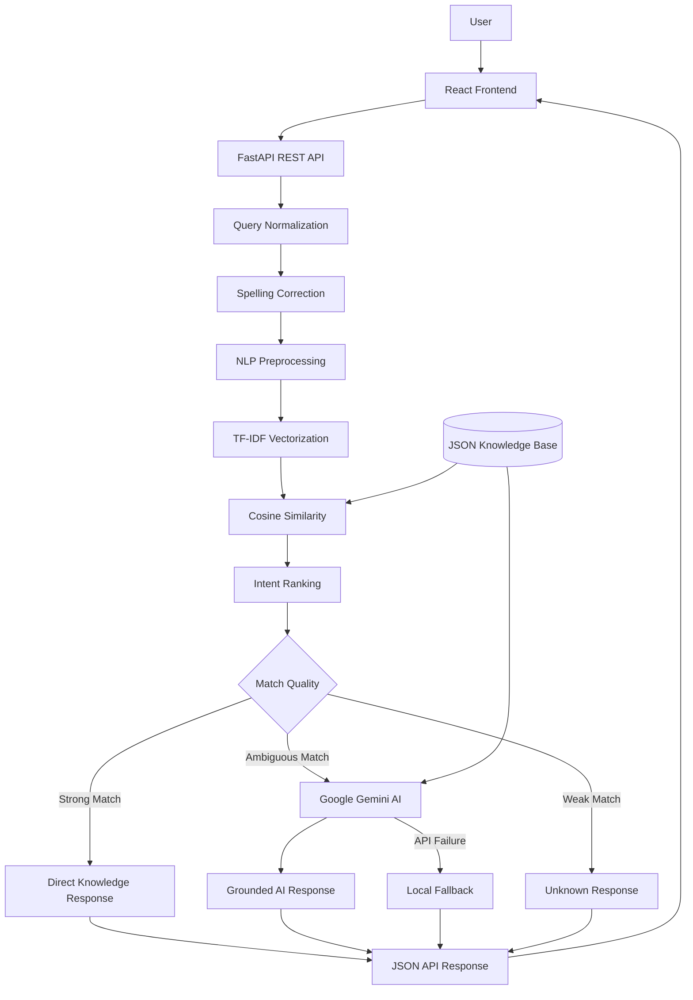

# CampusMind — AI-Powered College Enquiry Chatbot


## Overview

CampusMind is an AI-powered college enquiry chatbot designed to provide students, applicants and visitors with quick and relevant information about academic institutions.

The system combines Natural Language Processing (NLP), TF-IDF vectorization, cosine similarity, spelling correction and Google Gemini AI to deliver knowledge-grounded responses.

Unlike conventional keyword-based chatbots, CampusMind processes natural language queries and retrieves relevant information from a structured knowledge base.

The project uses Government College Dharamshala as a demonstration institution. Its architecture is designed to be adaptable to other colleges and universities by replacing or extending the knowledge base.

CampusMind is an independent academic project and is not an official college service.

---

## Live Demo

- **Website:** https://campusmind.bhupesh.website
- **Backend API:** https://campusmind-api-q782.onrender.com
- **API Documentation:** https://campusmind-api-q782.onrender.com/docs
- **GitHub Repository:** https://github.com/DARK7177/CampusMind

> The backend is hosted on Render. Initial requests may take longer when the service is waking up from inactivity.

---

## Features

### Intelligent Query Processing

- Natural Language Processing using NLTK.
- Text normalization and tokenization.
- Stopword removal.
- Porter stemming.
- English and Roman Hindi (Hinglish) query support.
- Automatic spelling correction using Difflib.
- Course-specific intent matching.
- Word-level unigram and bigram vectorization.

### Hybrid AI Engine

- TF-IDF-based information retrieval.
- Cosine similarity for intent ranking.
- Direct knowledge base responses for strong matches.
- Google Gemini integration for ambiguous queries.
- Knowledge-grounded AI response generation.
- Local fallback when the AI service is unavailable.
- Similarity threshold-based rejection of weak matches.

### College Information

- Undergraduate and postgraduate programmes.
- Course eligibility and admission procedures.
- Entrance examinations.
- Course-wise fee structures.
- Subsidised and non-subsidised seats.
- Selected course fee comparisons.
- Selected total course fee calculations.
- Scholarships and student support.
- Hostel and library facilities.
- Examination and attendance information.
- College contact details.
- Official prospectus and website links.

### Modern User Interface

- Responsive React-based frontend.
- Minimal black-and-white design with green accents.
- Animated particle background.
- Dark and light themes.
- Multiple chat sessions.
- Session-based conversation history.
- New chat and clear chat functionality.
- Suggested questions.
- Loading indicators.
- Markdown-formatted responses.
- Clickable official source links.
- Mobile-friendly layout.

---

## Technology Stack

| Layer | Technology |
| --- | --- |
| Frontend | React.js |
| Build Tool | Vite |
| Styling | Tailwind CSS and CSS |
| Icons | Lucide React |
| Animations | Particle-based background |
| Backend | Python |
| API Framework | FastAPI |
| ASGI Server | Uvicorn |
| NLP | NLTK |
| Stemming | Porter Stemmer |
| Vectorization | TF-IDF |
| Similarity Measurement | Cosine Similarity |
| Spelling Correction | Python Difflib |
| Machine Learning Library | Scikit-learn |
| Generative AI | Google Gemini API |
| Knowledge Base | JSON |
| Frontend Deployment | Cloudflare Pages |
| Backend Deployment | Render |
| Version Control | Git and GitHub |

---

## System Architecture



---

## How CampusMind Works

### 1. User Input

The user enters a question through the chat interface.

Example:

```text
BCA ki fees kitni hai?
```

The frontend sends the question to the FastAPI backend through a POST request.

### 2. Text Preprocessing

The chatbot normalizes the input by performing:

- Lowercase conversion.
- Punctuation removal.
- Common abbreviation normalization.
- Hinglish phrase normalization.
- Spelling correction.
- Stopword removal.
- Porter stemming.

This reduces variations in user input and improves matching.

### 3. TF-IDF Vectorization

Term Frequency–Inverse Document Frequency converts textual question patterns into numerical vectors.

TF-IDF assigns higher importance to words that are relevant to a particular pattern but less common across the complete collection.

The chatbot uses individual question patterns rather than treating an entire intent as a single training document.

Unigrams and bigrams help capture individual terms and short phrases.

### 4. Cosine Similarity

The chatbot compares the processed user query against stored question patterns using cosine similarity.

```math
\text{Cosine Similarity}(A,B)
=
\frac{A \cdot B}{\|A\|\|B\|}
```

Higher similarity indicates a closer textual match.

The system ranks candidate intents using the highest similarity of their associated patterns.

### 5. Intent Selection

The chatbot evaluates:

- Highest similarity score.
- Difference between competing intent scores.
- Course-specific information.
- Availability of relevant knowledge base responses.

Strong matches are answered directly from the knowledge base.

Ambiguous matches may be forwarded to Gemini with retrieved context.

Weak matches receive an appropriate fallback response.

### 6. AI-Assisted Response Generation

Google Gemini receives relevant information retrieved from the local knowledge base.

The AI is instructed to:

- Answer using supplied institutional information.
- Preserve exact fees, dates and eligibility criteria.
- Avoid inventing unavailable information.
- Maintain course-specific accuracy.
- Provide concise, structured English responses.

This implements a lightweight retrieval-augmented generation (RAG) approach using TF-IDF retrieval instead of an external vector database.

### 7. Response Delivery

The backend returns a JSON response containing:

- Response text.
- Matched intent.
- Similarity-based confidence score.

The React frontend displays the response in the chat interface.

---

## Knowledge Base

CampusMind uses a structured JSON knowledge base containing institutional information and multiple question patterns.

Each intent contains:

- Tag
- Patterns
- Keywords
- Response

Example:

```json
{
  "tag": "seats_fees_bca",
  "patterns": [
    "BCA fees",
    "BCA fee structure",
    "BCA ki fees kitni hai",
    "How many BCA seats are available"
  ],
  "keywords": [
    "bca",
    "fees",
    "seats"
  ],
  "response": "BCA fee and seat information with official source links."
}
```

The knowledge base can be extended without modifying the frontend or API architecture.

Institution-specific information can be replaced to adapt CampusMind to another college or university.

### Information Sources

The demonstration knowledge base uses information from:

- Official college website.
- College admission portal.
- Programme-specific prospectuses.
- Published academic information.
- Official institutional notices.

Reference websites:

- https://gcdharamshala.in/
- https://admission.gcdharamshala.in/
- https://gcdharamshala.in/download/

Information may change between academic sessions. Students should verify important admission and fee details using the latest official notices.

---

## Project Structure

```text
CampusMind/
│
├── backend/
│   ├── main.py
│   ├── chatbot.py
│   ├── knowledge.json
│   ├── requirements.txt
│   └── .env                  # Local configuration
│
├── frontend/
│   ├── public/
│   ├── src/
│   │   ├── App.jsx
│   │   ├── BackgroundParticles.jsx
│   │   ├── index.css
│   │   ├── portfolio.css
│   │   └── main.jsx
│   ├── package.json
│   ├── vite.config.js
│   └── index.html
│
├── .gitignore
└── README.md
```

---

## Installation and Setup

### Prerequisites

Ensure the following tools are installed:

- Python 3.10 or later.
- Node.js 20 or later.
- npm.
- Git.
- Google Gemini API key (optional).

### 1. Clone the Repository

```bash
git clone https://github.com/DARK7177/CampusMind.git

cd CampusMind
```

### 2. Backend Setup

Navigate to the backend directory:

```bash
cd backend
```

Create a Python virtual environment:

```bash
python3 -m venv .venv
```

Activate the virtual environment.

#### macOS / Linux

```bash
source .venv/bin/activate
```

#### Windows

```bash
.venv\Scripts\activate
```

Install dependencies:

```bash
python -m pip install --upgrade pip

python -m pip install -r requirements.txt
```

### Backend Dependencies

```text
fastapi
uvicorn
scikit-learn
nltk
python-dotenv
google-genai
```

### 3. Configure Environment Variables

Create a `.env` file inside the backend directory.

```env
GEMINI_API_KEY=your_gemini_api_key
GEMINI_MODEL=your_supported_gemini_model
```

A Gemini API key can be obtained from Google AI Studio:

https://aistudio.google.com/apikey

Use a Gemini model available to your API account.

Gemini integration is optional. The chatbot supports local knowledge base retrieval without an API key.

Never commit the `.env` file or expose API credentials publicly.

### 4. Start the Backend

```bash
python -m uvicorn main:app --reload
```

Backend server:

```text
http://127.0.0.1:8000
```

Interactive API documentation:

```text
http://127.0.0.1:8000/docs
```

### 5. Frontend Setup

Open a separate terminal and navigate to the frontend directory.

```bash
cd frontend

npm install
```

Create a frontend `.env` file:

```env
VITE_API_URL=http://127.0.0.1:8000
```

Start the development server:

```bash
npm run dev
```

Open:

```text
http://localhost:5173
```

---

## API Documentation

### Available Endpoints

| Method | Endpoint | Description |
| --- | --- | --- |
| GET | `/` | Application and engine information |
| GET | `/health` | Backend health check |
| POST | `/chat` | Process a user query |

### Chat Endpoint

```http
POST /chat
Content-Type: application/json
```

Request:

```json
{
  "message": "What is the BCA fee structure?"
}
```

Example response:

```json
{
  "response": "BCA fee information...",
  "intent": "seats_fees_bca",
  "confidence": 1.0
}
```

The confidence field represents a similarity-based matching score, not a calibrated probability or a guarantee of factual accuracy.

### Test Using cURL

```bash
curl -X POST http://127.0.0.1:8000/chat \
  -H "Content-Type: application/json" \
  -d '{"message":"BCA eligibility"}'
```

---

## Example Queries

```text
What courses are offered by the college?

What is the eligibility for BCA?

BCA ki fees kitni hai?

How many seats are available in BBA?

Compare BCA and BBA fees.

What is the total cost of BCA for three years?

What is the PGDCA admission process?

Is hostel accommodation available?

What are the library timings?

Can I borrow books at 6 PM?

What is the minimum attendance requirement?

How can I contact the college?
```

CampusMind accepts English and Roman Hindi questions while providing English responses.

---

## Testing

The NLP engine can be tested independently of the frontend.

```python
from chatbot import chatbot

questions = [
    "Hello",
    "BCA eligibility",
    "BCA ki fees kitni hai",
    "BCA admision proces",
    "PGDCA eligibility",
    "Library timings",
    "Is hostel available?",
    "College contact number"
]

for question in questions:
    result = chatbot.get_response(question)

    print("Question:", question)
    print("Intent:", result["intent"])
    print("Score:", result["confidence"])
    print("Answer:", result["response"])
    print("-" * 50)
```

Run the test from the backend directory.

### Evaluation Criteria

- Correct intent identification.
- Relevance of retrieved responses.
- English and Hinglish query handling.
- Spelling correction.
- Course-specific matching.
- Response formatting.
- Unknown query handling.
- Gemini fallback behaviour.

Similarity scores should not be interpreted as overall chatbot accuracy. A separate labelled test dataset is required for formal accuracy evaluation.

---

## Deployment

### Frontend — Cloudflare Pages

Recommended configuration:

| Setting | Value |
| --- | --- |
| Framework | React / Vite |
| Root Directory | frontend |
| Build Command | npm run build |
| Build Output Directory | dist |

Environment variable:

```env
VITE_API_URL=https://campusmind-api-q782.onrender.com
```

Production website:

https://campusmind.bhupesh.website

### Backend — Render

Recommended configuration:

| Setting | Value |
| --- | --- |
| Runtime | Python |
| Root Directory | backend |
| Build Command | pip install -r requirements.txt |
| Health Check Path | /health |

Start command:

```bash
uvicorn main:app --host 0.0.0.0 --port $PORT
```

Environment variables:

```env
GEMINI_API_KEY=your_gemini_api_key
GEMINI_MODEL=your_supported_gemini_model
```

Backend API:

https://campusmind-api-q782.onrender.com

---

## Security and Privacy

- Gemini API credentials are stored on the backend.
- Environment variables are excluded from version control.
- Cross-Origin Resource Sharing (CORS) is configured for supported frontend origins.
- User message length is validated using Pydantic.
- Conversation history is managed through browser sessions.
- No permanent user account database is required.
- The chatbot does not access private student records.
- Relevant queries and retrieved context may be sent to Google Gemini when AI-assisted generation is enabled.

Users should not enter passwords, personal identification numbers or confidential information.

---

## Limitations

- Responses depend on the quality and coverage of the knowledge base.
- Institutional information requires periodic updates.
- TF-IDF primarily measures lexical similarity rather than deep semantic meaning.
- Complex multi-intent questions may require additional retrieval logic.
- Fee comparisons and calculations are supported for selected predefined queries.
- Gemini availability depends on API connectivity and usage limits.
- AI-generated responses may still contain errors.
- The chatbot does not provide real-time admission status, seat vacancies or personal examination results.
- Conversation history in the frontend does not imply persistent conversational memory in the NLP engine.

---

## Future Enhancements

- Semantic search using sentence embeddings.
- Vector database integration.
- Automated official website and prospectus ingestion.
- Advanced multi-intent query processing.
- Dynamic fee calculations.
- Multi-college knowledge base support.
- Context-aware conversations.
- Multilingual response generation.
- Administrative dashboard for knowledge base management.
- Voice-based interaction.
- Automated evaluation and performance monitoring.

---

## Academic Project

| Field | Details |
| --- | --- |
| Project Title | CampusMind — AI-Powered College Enquiry Chatbot |
| Developer | Bhupesh Kumar |
| Roll Number | 3 |
| Programme | M.Sc. (Hons.) Computer Science |
| Specialization | Data Science |
| University | Panjab University |
| Subject | MDS-2605 — Minor Project |
| Related Subject | MDS-2602 — Programming in Python |
| Academic Session | 2026–27 |

This project demonstrates the practical application of Python programming, Natural Language Processing, information retrieval, machine learning techniques, REST API development and generative AI integration.

---

## Developer

**Bhupesh Kumar**

- GitHub: https://github.com/DARK7177
- Portfolio: https://bhupesh-portfolio7.netlify.app/
- Project: https://campusmind.bhupesh.website

---

## Acknowledgements

- Panjab University.
- Government College Dharamshala.
- Python and FastAPI communities.
- Scikit-learn and NLTK.
- Google Gemini AI.
- React and Tailwind CSS.
- Cloudflare Pages and Render.

---

<p align="center">
  Developed by Bhupesh Kumar
  <br/>
  CampusMind — Making Campus Information More Accessible
</p>
